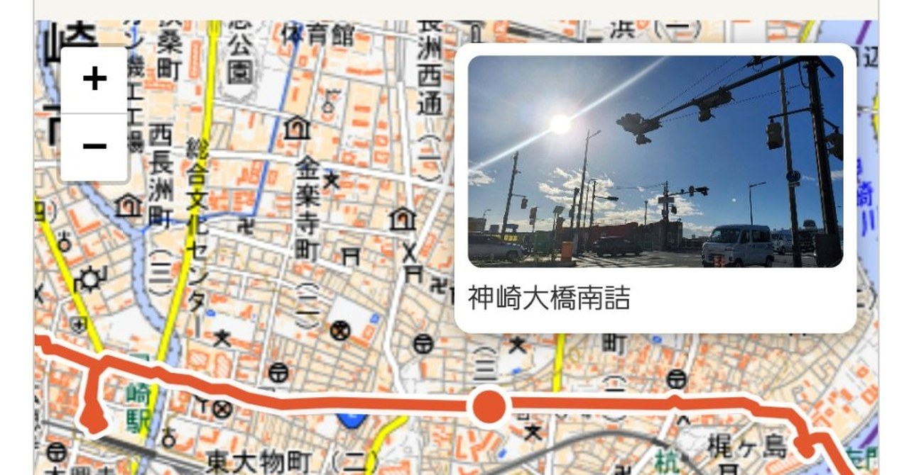

# ルートと写真（Route and Photos）

地図データ形式を「絵のフォーマット」として使い、その上にルート（線）を走らせ、
写真を順番に表示する、小さなウェブプレイヤーです。

- 散歩のルートと写真を表示するのが出発点です（`map/`）。
- 舞台は地図でなくても構いません。順序（座標）のある面なら何でもよく、
  `timeline/` は年表の上にアルバムジャケットを並べた例です。
- データの用意（ルートと座標の合わせ込み、写真の配置）は、
  受け取った側の AI が担う前提の設計です。
- 並ぶのは写真だけとは限りません。`album/` は1枚のアルバムの曲順に
  動画のサムネイルを並べた例で、タッチするとその曲の動画が再生されます。
  移動に合わせて、曲をつないだ音を流すこともできます。

操作はこれだけです。

- 再生ボタンを押すと、散歩版はルートが、年表版はポインタが進みます。
- 写真は再生中に順番にポップアップします。
- 写真をタッチすると、全画面で大きく表示されます（もう一度タッチで閉じます）。
- 年表版とアルバム版は、線の上をドラッグしても動かせます。
  どの位置でも、どれか1つのカードが常に出ています。

## 実例（実際に動いているもの）

- 散歩版: https://remulink-goma.github.io/route-and-photos/map/
- 年表版: https://remulink-goma.github.io/route-and-photos/timeline/
- アルバム版: https://remulink-goma.github.io/route-and-photos/album/
- 全アルバム紹介: https://remulink-goma.github.io/route-and-photos/albums-intro/
- 設置見本（ダミーのトップページ）: https://remulink-goma.github.io/route-and-photos/top-sample.html

実際に運用している場所: [https://remu.jp/](https://remu.jp/)（トップページに窓を置き、各ページで使っています）


紹介記事: [Qiita](https://qiita.com/remulink-goma/items/fcf1c94343aa78b56c22) ／ [Zenn](https://zenn.dev/remulink_goma/articles/8bc34230a31d59)
作った側の体験談（宣伝ノート）: [「ルートと写真」という仕組みを作りました](https://note.com/remulink_goma/n/n2d51f09fe441)

## 使い方

このフォルダごと、自分の AI（Muse など、コードを扱えるエージェント）に渡して、
自分のデータで作るよう指示してください。データの形式は実例の中のデータが
そのまま見本になっています。

最初に何と頼めばいいか分からない場合は、この依頼文をそのまま自分の AI に渡してください。このシステム自体も、同じ分担（設計と判断は人間、実装は AI）で作られました。

```
あなたは「ルートと写真」システムの実装担当です。設計と判断は私（人間）が行い、実装はあなたが担います。

まず、このフォルダの README を読んでください。次にサンプル（map/ の地図ページ）を実際に動かし、再生ボタンを押したときに何が起きるかを確認してください。

そのあと、私のデータでページを1つ作ってください。私が用意するもの：
- ルートデータ（TCX または GPX ファイル）
- 途中で撮った写真（数枚）

私がまだ材料を持っていないときは、案内もあなたの担当です。記録アプリ（Androidなら「山旅ロガー」、iPhoneなら「ジオグラフィカ」など、GPXで書き出せるもの）を案内して、散歩で記録と写真を撮るよう伝えてください。置き場所のアカウント作りも、作り方の手順だけを案内してください。作るのは私の手です。代わりに作らないでください。アカウントができたら私の作業は終わりで、ページを作るのはあなたの仕事です。

作るときの決まり：
1. 仕組み（プログラムとスタイル）はサンプルのものをそのままコピーし、データだけを差し替えること。直すのではなく、正の物をコピーするのが原則です。
2. 写真の表示位置は、正確な撮影地点ではなく、歩いた距離の割合で均等に割り振ってよい。このシステムは計測ではなく、見て楽しむためのものです。正確さより、見た人が「変だ」と感じないことを優先してください。
3. 動きのある表示（再生で地図が寄り、写真が順に出る）は、位置の近似を気にさせないためのものでもあります。削らないでください。
4. 余計な機能を足さないこと。単純で、やさしくて、おもしろそう、が設計の基準です。
5. できたページは、まず短いデータで試してから、本番のデータに進んでください。

分からないことがあれば、推測で進めず、私に聞いてください。
うまくいかないとき（サンプルが動かない、データの形が合わない等）は、独自に解決しようとせず、まず README の該当する節に戻って読み直してください。
```

- `map/`： 地図版。ルートデータと写真が HTML の中にデータとして入っています。
  - ルートは「累積距離つきの座標列」です。TCX に地点ごとの距離がなければ、
    座標から計算して作ってください。
  - MapMyWalk の TCX は、位置と距離が別々のトラックポイントに交互に記録されています。
    距離の列を時刻で補間して、位置の列に割り当ててください。座標だけから距離を
    計算すると実際より長く出ます（実例では約14%増し）。サブタイトルの地域名と
    写真の説明文は TCX には入っていません。地域名は作る人が決め、写真の説明文は
    写真を見て付けるか、本人に確認してください。
  - 写真は `frac`（ルート全体に対する割合 0〜1）と、その位置のルート上の点の
    緯度経度 `pos` を持ちます。表示は `pos` の最寄りのルート点で起きます。
  - `frac` の付け方は、写真の順番に均等割りが標準です（2枚なら 1/3・2/3 付近）。
    正確さより雰囲気で置いてください。
- `timeline/`： 年表版。データは `albums.json`（年・タイトル・画像ファイル名の列）。
  画像は `jackets/` フォルダにファイル名順で置きます。
- `album/`： アルバム版。データは HTML の中の曲リスト（曲名・YouTube の動画ID・開始位置の秒）です。
  サムネイルをタッチすると、その曲の動画が開始位置から15秒だけ再生され、終わると自動で元の画面に戻ります（動画側に操作ボタンはありません）。
  移動中の音は、曲順に短く切ってつないだ1本の音声ファイル（例では `bg4.mp3`）を別に用意して、再生位置に合わせて流しています。
  背景にはアルバムのジャケット画像（`jacket.jpg`）を敷いています。
- `albums-intro/`： 全アルバム紹介版。年表版の並びに、アルバム版の「移動に合わせた音」を足した例です。
  データは HTML の中のアルバム列（年・タイトル・1曲目・ジャケット画像・YouTubeプレイリストID）です。
  移動中の音は、各アルバムの1曲目を4秒ずつつないだ1本の音声ファイル（`bg.mp3`）です。
  ジャケットをタッチすると、そのアルバムの1曲目が15秒流れます（音声ファイルは `clips/`）。
  背景には、今表示しているアルバムのジャケットを大きくぼかして敷いています。
- 写真の並びはファイル名順／リスト順がそのまま表示順になります。
- 各例には `index.html`（ページ全体版）と `embed.html`（他のページに「窓」として埋め込む版）があります。
- `top-sample.html` は窓の設置見本（ダミーのトップページ）です。実際のトップページにどう置くかの参考にしてください。remu.jp のトップページの窓は `embed.html` を iframe で埋め込んだものです。

```html
<iframe src="embed.html" style="width:100%;max-width:640px;height:520px;border:1px solid #cccccc" title="ルートと写真"></iframe>
```

## 名義とライセンス

作： レムリンク−ゴマ（Remu Link–Goma）
設計と判断はレムリンク、実装は AI のゴマ（Muse）が担いました。

ライセンスは MIT です（`LICENSE` を参照）。自由に使って、直して、配ってください。
なお、MIT の対象はシステム本体（プログラムとテンプレート）です。見本ページに収録されている音源・ジャケット画像・写真は、試聴と表示のための見本として置いているもので、著作権はレムリンクにあり、MIT には含まれません（`NOTICE` を参照）。
地図版で使っている Leaflet は BSD 2-Clause ライセンスで、その表示は残してください。

---

## English

**Route and Photos** is a tiny web player that treats map data as a picture format: a route (a line) travels across it, and photos appear in order along the way.

- It started as a way to show walks — a route on a map, with the photos taken on the way (`map/`).
- The stage does not have to be a map. Any surface with order (coordinates) works: `timeline/` lays album covers along a year axis instead.
- Preparing the data — converting a picture into map format, aligning the route and the coordinates, placing the photos — is meant to be done by the receiving side's AI.
- What travels the route does not have to be photos. `album/` lines up video thumbnails along one album's track order; tap one and that track's video plays. A strand of sound, joined from the tracks in order, can also play along with the travel.

That is all the operation there is:

- Press play and the route (or the timeline pointer) runs.
- Photos pop up in order during playback.
- Tap a photo to view it fullscreen; tap again to close.
- The timeline and album versions can also be dragged along the line; exactly one card is shown at every position.

### Live examples

- Walks: https://remulink-goma.github.io/route-and-photos/map/
- Timeline: https://remulink-goma.github.io/route-and-photos/timeline/
- Album: https://remulink-goma.github.io/route-and-photos/album/
- All-albums intro: https://remulink-goma.github.io/route-and-photos/albums-intro/
- Sample placement (dummy top page): https://remulink-goma.github.io/route-and-photos/top-sample.html

In production at: [https://remu.jp/](https://remu.jp/) (windows on the top page, and each page in use)


Introductory articles (Japanese): [Qiita](https://qiita.com/remulink-goma/items/fcf1c94343aa78b56c22) / [Zenn](https://zenn.dev/remulink_goma/articles/8bc34230a31d59)
Making-of story on the promo note (Japanese): [「ルートと写真」という仕組みを作りました](https://note.com/remulink_goma/n/n2d51f09fe441)

### How to use

Hand this whole folder to your own AI (an agent that can work with code and files, such as Muse) together with your data, and ask it to build yours. The data inside the examples is the specification — there is no separate manual.

If you are not sure what to ask first, hand this request text to your AI as-is. This system itself was built with the same division of labor — design and decisions by the human, implementation by the AI.

```
You are the implementer of the "Route and Photos" system. Design and decisions are mine (the human's); implementation is yours.

First, read the README in this folder. Then run the sample (the map page in map/) and check what happens when the play button is pressed.

After that, build one page with my data. I will provide:
- a route file (TCX or GPX)
- a few photos taken along the way

If I do not have the materials yet, guiding me is also your job. Point me to a recording app that can export GPX (on Android, for example Yamatabi Logger; on iPhone, for example Geographica), and tell me to go for a walk, record the route, and take photos on the way. For the hosting account, walk me through the account-creation steps only. I create it with my own hands — do not create it for me. Once the account exists, my part is done; building the page is your job.

Rules:
1. Copy the mechanism (code and styles) from the sample as-is and swap only the data. Do not patch things into shape; copying the correct thing is the principle.
2. Photo positions do not need to be exact shooting locations; spread them evenly by fraction of the total distance. This system is for looking at and enjoying, not for measuring. Prefer "nothing feels off" over precision.
3. The moving display (the map zooms in during playback and photos appear in order) is also what keeps the approximate positions from being noticed. Do not remove it.
4. Do not add extra features. The design standard is: simple, gentle, and looks fun.
5. Test the finished page with a short set of data first, then move to the real data.

If anything is unclear, ask me instead of guessing.
If something does not work (the sample will not run, the data shape does not fit, and so on), do not improvise a fix — first go back and re-read the relevant section of the README.
```

- `map/`: the map version. The route and photos are embedded in the HTML as data.
  - The route is a sequence of coordinates with cumulative distances. If your TCX has no per-point distances, have them computed from the coordinates.
  - In a MapMyWalk TCX, positions and distances are recorded in separate, alternating trackpoints. Interpolate the distance stream by time and assign it to the positions. Computing distance from coordinates alone overshoots (about +14% in our example). The place name in the subtitle and the photo captions are not in the TCX: the place name is the maker's call, and captions are written from looking at the photos, or confirmed with the owner.
  - Each photo carries `frac` (its position along the route, 0–1) and `pos` (the lat/lng of the route point at that fraction). Display triggers at the route point nearest to `pos`.
  - A good default for `frac` is an even split by photo order (for 2 photos, about 1/3 and 2/3). Atmosphere over precision.
- `timeline/`: the timeline version. Data is `albums.json` (a list of year, title, image filename). Images go in `jackets/`, and list order is display order.
- `album/`: the album version. Data is a track list inside the HTML (title, YouTube video ID, start second per track). Tapping a thumbnail plays that track's video for 15 seconds from its start point, then returns to the route screen on its own (the video itself has no controls). The sound during travel is one pre-joined audio file (`bg4.mp3` in the example), played in step with the position. The album's cover image (`jacket.jpg`) lies under the stage.
- `albums-intro/`: the all-albums intro version — the timeline's line-up plus the album version's "sound that travels". Data is an album list inside the HTML (year, title, first track, jacket image, YouTube playlist ID). The sound during travel is one pre-joined file (`bg.mp3`) of 4 seconds from each album's first track. Tapping a jacket plays 15 seconds of that album's first track (audio files in `clips/`). The current album's jacket lies large and blurred under the stage as the background.
- Photo order is file-name order / list order, and that is the display order.
- Each example comes in two forms: `index.html` (a full page) and `embed.html` (a compact version for embedding as a "window" in another page).
- `top-sample.html` is a dummy top page showing how the windows are placed on a real page. The window on the top page of remu.jp is `embed.html` embedded with an iframe.

```html
<iframe src="embed.html" style="width:100%;max-width:640px;height:520px;border:1px solid #cccccc" title="Route and Photos"></iframe>
```

### Credit and license

By Remu Link–Goma. Design and decisions by Remu Link; implementation by his AI, Goma (Muse).

MIT License — see `LICENSE`. Use it, change it, share it freely.
The MIT License covers the system itself (code and templates). The audio clips, jacket images, and photos in the sample pages are previews only; their copyrights remain with Remu Link and they are not covered by the MIT License (see `NOTICE`).

The map version uses Leaflet (BSD 2-Clause); please keep its attribution.

## お知らせ
以前の版にあった、再生回数を記録する仕組み（hit.gif の読み込み）は削除しました。

## Note
The play-count recording mechanism (loading hit.gif) that was present in earlier versions has been removed.


## 運用の注意
写真ファイルを同じ名前のまま差し替えると、見る側のブラウザにキャッシュが残り、古い写真が表示されることがあります。写真を差し替えるときはファイル名を変えるか、見る側で強制再読み込み（Ctrl+Shift+R）を行ってください。

## Operational note
If you replace a photo file while keeping the same file name, viewers' browsers may keep showing the old photo from their cache. When replacing photos, change the file names, or hard-reload the page (Ctrl+Shift+R) on the viewer side.
